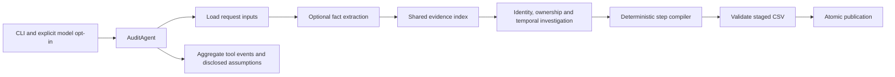

# Agent architecture and engineering decisions

This is a bounded audit workflow with one coordinator. Optional models extract
facts or classify ambiguous intent; deterministic code reconstructs state and
compiles the answer. The default submission replays the author's cached image
extraction and makes zero live model calls. It is not a multi-agent conversation
or an open-ended model loop. Original work is credited in [UPSTREAM.md](UPSTREAM.md).

## Source map and authority

| Component | Entry point | Responsibility and boundary |
| --- | --- | --- |
| Coordinator | `audit_agent.py:AuditAgent.run` | Executes a finite sequence, records failures, validates before publication. |
| Tools | `audit_tools.py:AuditTools` | Narrow typed inputs/outputs and declared effects; replaceable for failure tests. No production deletion or shell capability. |
| Evidence | `evidence/index.py:EvidenceIndex`, `evidence/ledger.py:EvidenceLedger` | One parsed index shared across requests; source IDs/hashes, both clocks, identifying fields and locations; extraction outcomes and unresolved references separate from findings. |
| Identity and ownership | `identity.py`, `linking.py`, `workflow.py` | Keep identifier links separate from inherited workflow/naming inference. |
| Investigation | `investigate.py:investigate_all` | Applies the inherited category-action profile to reconstructed resource states. |
| Plan compiler | `policy.py:steps_for` | Builds findings, proposed remediation and future checks; deduplicates, sorts and numbers deterministically. Does not execute remediation. |
| Model port | `llm.py:CachedLLM` | Versioned content-addressed cache, schema checks on cache hits and live responses, metering and a default 32-invocation live budget. |
| Output guard | `validate_output.py:validate` | Checks rows, IDs of cited evidence, citation times, phases, operations, states, ordering and status combinations. |
| Evaluation | `evaluation/local_report.py` | Produces predictions before opening reference answers; separates status, step, field and full-case metrics. |

The tool contracts are actual runtime dependencies, not unused descriptions.
`main.py` calls the coordinator, and the coordinator calls the declared tools.
`agent_run_trace.json` records a real full run. Durations vary; the CSV hash is the
reproducibility assertion. Trace events contain aggregate counts and error types,
not customer text, credentials or private model reasoning.

## Prompt and tool design

`prompts/image_facts_v3.md` limits new live extraction to visible facts and an
exact JSON shape. Unknown fields remain explicit; unresolved new extraction
fails instead of creating an observation of safety. Source IDs, source SHA-256
and capture clocks are bound by code. Historical v2 cached facts retain their
original prompt version and authorship; they have not been regenerated using v3.

`prompts/intent_fallback_v3.md` runs only after deterministic intent rules return
UNSURE. Customer text is encoded as a JSON string and explicitly labeled
untrusted. A closed schema separates deletion, access, correction, export,
marketing opt-out, restoration, questions and unknown intent. Literal supporting
offsets, negation, conditional scope and retention permission are validated on
live responses and cache hits. Models cannot emit final steps, choose evidence
IDs or select arbitrary tools. The older v2 prompt/cache provenance is retained.
These controls reduce injection exposure; prompt instructions alone are not a
proof of resistance to every adversarial message. Tests verify encoding and
schema enforcement without making that stronger claim.

Provider calls require `--live-llm`. There are at most 32 adapter invocations per
model wrapper by default; the Gemini adapter has at most three attempts and a
120-second per-attempt timeout. Cached replay does not consume the live budget.
Model failures return no fact/classification; missing image extraction blocks
publication at the coverage gate. Unresolved intent now raises a fixed error
and stops publication; it is never mapped to NOT_APPLICABLE. Missing cache,
provider failure, exhausted budget, invalid response and parser failure remain
distinct uncertain outcomes. Corrupt response caches are not overwritten by a
live fallback.

## Failure containment and engineering choices

- Manifest paths resolve inside `dataset/evidence/`; duplicate source IDs fail.
  Source IDs are safe identifiers. Loaders route by file format, including files
  outside conventional subdirectories. Every manifest entry has a ledger outcome.
  SQLite snapshots run in memory with external attachment/extension access
  denied and a roughly two-million-instruction work budget. Parser errors stop
  publication after the ledger has collected outcomes for the other files.
  Empty parser output is not an absence witness. Only declared scoped snapshots
  or explicit negative reads can establish absence.
- Models produce structured data, which is validated even when read from cache.
  Corrupt cache entries are not accepted as hits. Cache writes use atomic
  replacement so an interrupted write cannot create a partial response.
- Publication writes a temporary file beside the target, validates it, backs up
  the previous output by hash, then uses `os.replace`. Rejected candidates are
  removed, and the prior output remains intact. Dataset files cannot be selected
  as output destinations.
- Tool failures record their error class rather than potentially sensitive
  exception messages. There is no automatic retry of an entire audit or an
  unbounded model repair loop. Actual provider retries remain bounded.
- Dependencies are small; offline operation needs pdfplumber, not the optional
  provider SDK. Unit tests substitute model and tool boundaries without network
  access. The extracted source ZIP must reproduce the exact CSV hash.

`--ledger path.json` exports the versioned detailed ledger atomically, including
observations and failed extraction records. It is written before publication,
including failure diagnostics when indexing rejects the corpus. It may contain
source text and identifiers; aggregate `--trace` output does not. Paths cannot
overwrite the dataset, CSV or trace. Weak PDF text is rendered for inspection;
without a complete trusted visual extraction it remains REVIEW_REQUIRED.
Screenshot facts with visible labels but no grounded IDs remain unresolved
references. They do not create invented resource IDs or findings.

See [REQUEST_LEDGER.md](REQUEST_LEDGER.md) and
[evaluation/request_ledger_report.md](evaluation/request_ledger_report.md) for the
contract, current measured results and remaining inherited assumptions.

## Honest limits of this profile

This refactor preserves the previous prediction bytes. The inherited profile
still uses timing windows, numeric case-order tie breaks, a generated account
naming fallback, retrospective ownership membership, category-action mappings
and some unknown-field defaults. New prompt safeguards do not retroactively
correct historical extraction or make those assumptions direct evidence.

The trace reports unknown resource states; it does not silently label the whole
inventory proven. The output validator cannot prove ownership, policy fidelity,
physical-copy coverage or hidden-answer correctness. The category-action profile
is not a general dynamic policy interpreter. These limitations remain material
for broader deployment. The independent stricter implementation is preserved
outside the submission under `archive/independent-20261025/`.

This pass improves inspectability, execution boundaries and failure handling.
Public accuracy and the hidden leaderboard score are separate measures; an
engineering refactor does not establish a higher CSV score.
