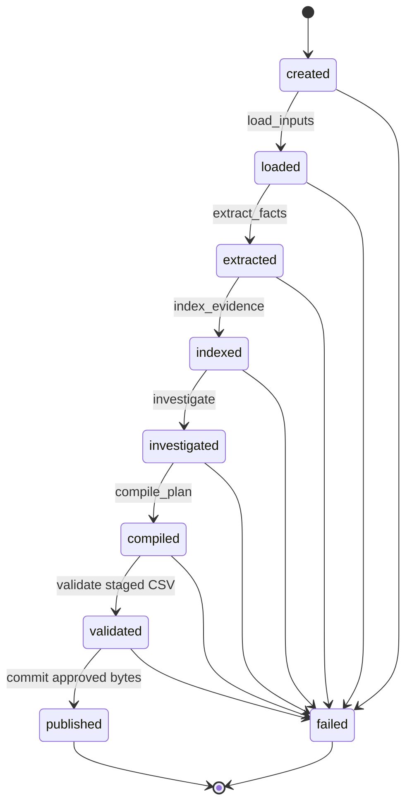

# Audit agent engineering design

The executable entry point is `main.py`. It constructs `benchmark_agent.AuditAgent`, which coordinates the typed dependency port in `audit_tools.py`. Evidence parsing, ownership candidates, state reconstruction, policy compilation and output validation remain separate responsibilities. The coordinator never performs production deletion operations.

## Bounded orchestration

`RunState` and the immutable transition table enforce this order in the real dispatcher. A tool cannot publish early or declare additional effects. Ledger export is a side operation allowed after indexing or after a failure with available extraction diagnostics. Each run resets its trace and candidate approval; failures do not authorize another stage.

The workflow is finite because the task has a fixed evidence corpus and output contract. Model interpretation is confined to two narrow purposes; it cannot select a new tool, create a remediation command or loop until an answer looks acceptable.

## Tool boundary

| Tool | Input | Output | Permitted effects |
|---|---|---|---|
| load_inputs | Dataset path | Read-only `AuditInputs` request mappings | Read participant requests |
| extract_facts | Dataset path, optional `JsonModelPort` | Validated extraction outcomes | Read evidence; write derived cache; configured inference only when explicitly authorized |
| index_evidence | Dataset path | Shared `EvidenceIndex` and extraction ledger | Read evidence/cache; create derived review images when needed |
| investigate | Inputs and the existing index | Complete case-investigation mapping | Resolve identity, ownership candidates and eligible states; constrained intent fallback if required |
| compile_plan | Investigations | `PredictionRow` list | Pure computation |
| validate | Staged CSV and dataset path | Checked row count and `ValidatedCandidate` approval | Read-only validation |
| publish | Approved staged artifact | Atomic output replacement | Write the selected output and a digest-named backup |

The `AuditToolPort` and `JsonModelPort` protocols make these dependencies replaceable in tests. Contract checks reject wrong return shapes, missing case membership, malformed validator results and capability changes. These checks are application boundaries, not an operating-system sandbox for arbitrary replacement Python code.

The evidence index is constructed once per run and reused across all requests and joint workflow assignment. It is not rebuilt by individual case investigations. Request mappings are read-only to prevent an adapter from silently changing the customer input seen by another stage.

## Model and prompt contracts

- Screenshots and customer messages are untrusted data. The versioned prompts explicitly reject instructions embedded in them.
- Screenshot output contains facts and explicit unknowns. It cannot contain final citations, generated identifiers or remediation. Source ID, content hash and capture time are bound by code.
- Intent output uses a closed schema, an explicit uncertain label and supporting offsets in the original message. Rules handle reliable cases first; absent, malformed or failed interpretations do not become confident non-deletion labels.
- Cached responses pass validation too. Cache keys bind provider/model, task, prompt version/text and input image hashes. Existing extraction provenance is preserved when prompts change.
- The model adapter has invocation limits, bounded provider attempts and per-attempt timeouts. Adapter invocations and SDK attempts are distinct concepts; no universal semantic correctness or cost completeness is inferred merely from valid JSON.
- Final policy decisions, operation vocabulary, citations, ordering and serialization are code responsibilities. Proposed audit steps are data, not executable model actions.

The actual schemas and validators live beside their consumers in `image_extract.py` and `intent.py`. Prompts are in `prompts/`; the independent implementation's separate interfaces remain under `audit_agent/` and `proof_main.py`.

## Publication transaction

1. Serialize all target rows to a unique temporary file beside the destination; flush and sync its bytes.
2. Hash the staged file, run the independent output validator and require the exact target count.
3. Reject a validator that changes the candidate it was permitted only to inspect.
4. Create an immutable `ValidatedCandidate` containing the path, digest and validated count.
5. Recheck that approval immediately before replacing the output. Back up the previous output by digest, then use same-filesystem atomic replacement.

The digest guard detects candidate changes before publication; it is not a claim of protection against a privileged process with arbitrary concurrent filesystem access. Dataset paths cannot be used as output, diagnostic or backup destinations.

JSON diagnostics use the shared atomic writer in `audit_artifacts.py`. Requested trace output is checked before CSV commit. A later trace-finalization failure is a diagnostic warning and cannot turn a committed valid CSV into a reported failed audit. Failures writing a diagnostic ledger or removing a temporary candidate cannot mask the original audit error. Warnings and failure records contain fixed codes or exception class names, never exception messages containing customer data or credentials.

## Verification and limits

The tests exercise failed stages and malformed tool results, changed candidates, diagnostic failures, source confinement, parser budgets, corrupt caches, unknown extraction, deterministic output and publication rollback. Fake tools and clients avoid network calls. Release checks extract the actual ZIP and run the packaged entry point against the participant inputs before delivery.

Engineering hardening preserves prediction behavior; it does not resolve inherited workflow timing, case-order ties, naming fallback, retrospective ownership, physical-copy reduction or conditional-policy limitations. Those assumptions remain visible in the trace and evidence documentation. A structurally valid CSV alone does not prove the correctness of inferred ownership or every missing relationship.
