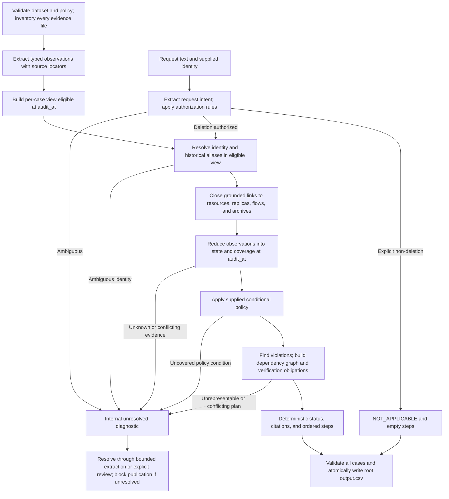

# Bounded deletion-audit architecture

Design baseline: 25 October 2026, documented before implementation. The initial coordinator is now implemented; see [COORDINATOR.md](COORDINATOR.md) for executable tool boundaries, measured tests and current adapter limits. The design below includes future capabilities and must not be read as a claim that all are implemented.

## 1. Decision and scope

Use a finite, evidence-driven audit pipeline with deterministic identity joins, time filtering, state reduction, policy decisions, remediation planning, and CSV serialization. Optional AI extracts literal facts from difficult business artifacts or request language. It never decides the final deletion status or invents actions. A model-free run is supported only when configured deterministic extractors cover every required input; disabling AI must not silently skip unsupported evidence.

The product is an offline audit and proposed remediation plan over the supplied dataset. It does not delete real records, contact users, disable live connectors, or claim that future verification has executed. Completion is relative to the supplied evidence and its coverage, not proof about Northstar systems outside the dataset.

## 2. Sources, attribution, and inspection baseline

The challenge, fictional Northstar Shop scenario, dataset, policy categories, operation vocabulary, sample answers, and starter layout originate from the HackerRank / InterviewStreet starter repository identified in the supplied README:

- [HackerRank challenge](https://www.hackerrank.com/contests/hackerrank-orchestrate-october26/challenges/ghost-data-still-exists)
- [InterviewStreet starter repository](https://github.com/interviewstreet/hackerrank-orchestrate-october26)
- Local baseline commit: `0eddbbd33f682eae0a2770d67412af8a3cf4af20`.
- Local specification: [problem_statement.md](../problem_statement.md), [AGENTS.md](../AGENTS.md), and [README.md](../README.md). `CLAUDE.md` delegates to `AGENTS.md`.
- [Agent trace instructions](../agent_trace_instructions.md) describe a separate trace export; they do not replace the root `log.txt` contract.

The public challenge page could not be fetched during this review. Requirements below are grounded in the supplied local statement and instructions; online parity has not been verified. The event deadline is not configured. No LICENSE or NOTICE file was found in the inspected checkout; no external license or ownership assertion is made. This architecture is a proposed participant design, not an organizer reference solution.

Inspection covered the complete local statement and `AGENTS.md`, README and trace guidance, every CSV header and row count, all 15 policy rules, JSON structural families, SQL table declarations, representative log syntax and evidence content, all four PDFs through text extraction and rendered pages, and five representative screenshots (account, customer reference, connector, backup, marketing). All 94 manifest paths exist, with no unlisted evidence files. The remaining six screenshot contents have not yet been visually reviewed. This is schema and architecture review, not a case-by-case audit.

At the initial inspection, `code/main.py` and `code/evaluation/main.py` were zero-byte placeholders, with no inherited parsing, retrieval, model, or decision implementations to preserve. The initial implementation and current synthetic-fixture results are described in [COORDINATOR.md](COORDINATOR.md); final dataset accuracy and final-run cost remain unmeasured. The supplied dataset and policy remain unchanged.

See [DATA_CONTRACT.md](DATA_CONTRACT.md) for observed schemas, adapter requirements, and policy mapping.

The implemented observation/ownership/inference separation, scoped negative readbacks, explicit unknown values and assumption registry are described in [EVIDENCE_REASONING.md](EVIDENCE_REASONING.md), including the structural refactor's unchanged fixture predictions and unresolved correctness concerns.

Implemented model access is narrower than the original generic extraction proposal: only PNG screenshot facts and grammar-unresolved intent are admitted. [MODEL_EXECUTION.md](MODEL_EXECUTION.md) documents versioned prompts, strict live/cache validation, opt-in client execution, process timeouts, budgets and reported usage. SQL/log/PDF gaps remain deterministic-adapter work.

## 3. Request-to-CSV path

Extraction can be shared across cases; reasoning cannot use a global unfiltered identity or resource graph. Every graph edge, observation, and supporting reference must be eligible for that case before traversal. Public sample outputs belong exclusively to evaluation and never feed this graph.

### Stage ownership and rationale

| Component | In deterministic code | Optional prompt responsibility | Why this boundary |
| --- | --- | --- | --- |
| Input and manifest loader | Exact schemas, unique IDs, paths, timestamps, file hashes, complete inventory | None | Missing or changed inputs must be observable and reproducible. |
| Evidence adapters | CSV, JSON, SQL structure, log grammar, trace joins, PDF text/OCR normalization | Extract fields from unsupported layouts or ambiguous prose, with exact source spans | Structured parsing is cheaper and preserves nulls and types; models help with layout and language. |
| Request gate | Rules over affirmative intent, negation, requested action and scope; explicit unresolved path | Extract asserted action, negation, conditions, and quoted text, optionally translation | A keyword or an intake classifier must not authorize deletion. |
| Temporal identity resolver | Alias normalization, validity intervals, collision checks, evidence-backed joins | Extract identifier strings from an artifact | Entity membership must be traceable; models must not merge similar names. |
| Evidence linker | Exact indexes, qualified resource joins, bounded graph closure, coverage accounting | No autonomous search; optional extraction on selected artifact | A global file can contain decoys; ranked snippets are not a completeness proof. |
| State reducer | Point-in-time ordering, scope comparison, uncertainty, conflict handling | None | Reported success and actual stored state differ; decision logic must be testable. |
| Policy engine | Versioned rules and explicit condition predicates, treatment checks | Extract facts supporting conditions, never select the rule/action | Retention and tombstone handling cannot depend on model improvisation. |
| Planner | Violations, dependencies, legal operation mapping, retained-data invariants | None | Stable operation vocabulary and safe precedence are contract requirements. |
| Serializer and evaluator | Citation validity, exact keys/enums/order, CSV round trip, metrics and usage accounting | None | Hidden grading compares structured values and significant array order. |

The proposed implementation can remain a small Python program split into adapters, domain types, identity, reconstruction, policy, planning, output validation, and evaluation modules. No agent framework, vector database, hosted database, or cloud deployment is required for this dataset size. These are module responsibilities, not files already implemented.

## 4. Internal domain contract

Keep richer reasoning records internally and project only permitted fields into the submission.

| Internal object | Required information |
| --- | --- |
| `AuditCase` | Original request fields; parsed UTC cutoff; intent facts and matched authorization rule; subject-resolution outcome |
| `IdentityAlias` | Stable subject, identifier type, original and normalized value, validity interval if known, availability time, supporting audit/file/identity-row locator |
| `Observation` | Source ID and path; page/line/JSON pointer/table+row; source hash; system, collection, resource; physical replica/region; observed time; available time; extracted fields; evidence kind; support links; extractor/version |
| `ResourceState` | Logical resource and its physical copies; category and rule; existence; direct identifiers; attribution links; flow/restore state; retention/hold facts; latest compatible observations; conflicts; coverage |
| `PolicyObligation` | Subject and resource; rule and condition witnesses; required final state; satisfied/violated/unresolved; proof references |
| `AuditPlan` | Findings; action nodes; dependency edges; all final verification obligations; internal assumptions and unresolved diagnostics |
| `RunManifest` | Input and policy hashes; parser/prompt/model versions; extraction cache keys; budgets; counts; usage; output digest |

Do not overload a single status string: existence, exposed identifiers, attribution, retention, connector activity, and restore access are different facts. Represent unavailable fields as unknown, explicit nulls as cleared only when the source semantics support that interpretation, and conflicting observations as conflict. A redacted record must also exist; a missing retained record is a violation even when no PII remains.

The CSV supports no uncertainty field. `UNRESOLVED` is internal only. It must not be serialized as a new status, mapped to `NOT_APPLICABLE`, or converted to a fabricated finding. If unresolved cases remain, produce diagnostics and fail publication of the final CSV. This is a known tension with the requirement to submit 518 answers; resolve it before the final run rather than output plausible defaults.

## 5. Request authorization and identity

1. Read `request_text` independently of `reported_status` and activity intake labels. Preserve the original language. Extract the requested action, object, negation, conditional wording, and scope.
2. Clear requests to erase the account/personal data authorize the bounded deletion audit. Access, export, correction, login assistance, and marketing-only opt-out produce `NOT_APPLICABLE` with `[]`. Ambiguous, mixed, conditional, or partially scoped deletion requests require an explicit rule or review; lack of a recognized deletion keyword is not proof of non-deletion.
3. Resolve the supplied email against eligible current and historical aliases. Keep all grounded old email, phone, name, hash, and stable-user-reference links that can still locate old records. Maintain history rather than replacing old values with the current snapshot.
4. Preserve original text. Use Unicode normalization and explicit email case handling with collision detection; do not strip plus tags/dots or transliterate names to manufacture equivalence. Phone normalization needs a supplied country context; names alone are candidate hints. Treat supplied hashes as opaque unless an explicit hash convention is established.
5. Require a unique grounded subject, or retain the ambiguity. Never infer identity or resource IDs from a `case_id`, numeric suffix, filename, sample similarity, or observed ordering of rows.

Current identity rows have `updated_at`; historical changes have `event_time`. A current value updated after a case cutoff is not automatically an identity fact available at that cutoff. The strict default is to use eligible facts only. Whether later identity metadata may be used purely to discover an earlier alias is not expressly exempted by the contract and remains an open issue (section 11). Do not backdate future identity edges silently.

## 6. Evidence discovery, time, and state reconstruction

### Complete bounded discovery

Inventory and extract every manifest artifact once. Index normalized identifiers, stable user references, `(system, resource_id)`, collection/replica, trace IDs, object keys, and explicit source/target links. Per authorized case, construct the eligible view, then follow grounded identifier-to-resource and resource-to-resource edges until no new eligible links appear. Visit each edge/node at most once per view. Retain provenance for the whole path; a resource with all identifiers removed still needs an earlier eligible subject-to-resource link.

Search the global activity stream by grounded resource or subject links, not just request email. Follow linked replicas, support attachments, exports, connectors, archives, and restore targets. A manifest origin locates an artifact; it does not establish subject membership or universal source reliability. A ranked retrieval limit cannot exclude relevant copies. If an extraction/size/graph budget is reached, mark incomplete coverage and stop that case as unresolved.

### Two distinct times

Use timezone-aware UTC comparisons; the case cutoff is inclusive. A file fact is usable only when its enclosing manifest capture, applicable export/snapshot availability times, and its own observation time are at or before `audit_at`. Keep nested snapshot times separate from outer export times. For a conservative availability calculation, use the latest applicable capture/export boundary. An old observation inside a later-delivered artifact cannot affect an earlier audit. An internal creation date describes when a record began, not necessarily when the auditor could observe it.

Activity and audit rows use their event times as the supplied availability boundary because they have no ingestion timestamp; record that assumption. Missing time, conflicting outer/inner times, or an unrecognized timezone yields a diagnostic, not a guessed timestamp from the filename.

### Reconstruction rules

- Keep operation claims separate from direct reads. A submitted deletion or `reported_result=SUCCESS` alone does not establish absence. A trace-correlated query result, explicit readback, scoped inventory, or concrete record can establish state when its semantics and scope are known.
- Correlate multi-line log events by trace, service, resource, and time; do not join adjacent lines or same-name users accidentally. A cache miss, retry, timeout, disabled download link, or tombstone label alone does not establish deletion.
- Compare observations chronologically within the same physical copy and query scope. A later authoritative read can supersede an earlier one; a later workflow claim cannot erase a conflicting concrete read. No universal file-format precedence or majority vote is justified.
- Compare replicas independently. A missing primary cannot erase a present regional, reporting, or failover record. Aggregate compliance across all relevant copies and preserve their individual witnesses internally.
- Negative evidence requires an explicit resource lookup or a demonstrably complete snapshot for the relevant scope. Absence from a partial list, failed search, or absent keyword is unknown.
- Carry a supported state forward only within documented coverage and with no contrary intervening evidence. A later sync/restore/write claim can invalidate confidence in an earlier absence even when it cannot independently prove a new record. Equal-time contradictory reads remain unresolved.
- Keep required retained records in the inventory. A stable internal user reference is permitted in a correctly redacted tombstone and in policy-permitted retained records; it is not globally permitted in analytics anonymization.

`COMPLETE` therefore requires positive support for all applicable final obligations and sufficient coverage, not merely an empty findings list. This dataset offers snapshots, not continuous surveillance; continuity between observations remains an explicit assumption.

## 7. Policy and remediation semantics

Load all 15 supplied rules as data, with explicit, reviewed predicates for their natural-language conditions. Do not derive treatment from the system name: an analytics system may contain a secondary identifier requiring deletion. Unknown categories, unproven conditions, or overlapping incompatible rules yield unresolved obligations. Do not invent legal retention periods or default to deletion outside the supplied policy.

The detailed mapping is in [DATA_CONTRACT.md](DATA_CONTRACT.md). The following invariants govern it:

- `DELETE`: the whole prohibited record must be absent across relevant copies.
- `REDACT`: the permitted record remains, and prohibited identifying fields and free-text identifiers are removed. For `ACCOUNT_TOMBSTONE`, preserve the stable internal subject reference and required reference structure while removing name, email, phone, email hash, and any other prohibited direct identifiers supported by the rule and record schema.
- `ANONYMIZE`: the record remains only after supported irreversible unlinking. Removing an email alone does not prove unlinking if a user ID, phone, hash, message, or join key still attributes it to the person.
- `RETAIN`: preserve the required record while satisfying any applicable identifier restrictions. For backups, retain the archive under rule 14 and separately block unsafe restoration under the challenge's recreation-risk requirement. Retention and restore blocking are different obligations.

Build a dependency graph from actual source/target, connector, replica, and restore relationships. Disable relevant data flows and block unsafe restores before changing affected records. When required, treat downstream copies before their source. Preserve retained records and necessary tombstone references throughout the plan. Unknown dependencies must not be replaced by a guessed universal system ordering; cycles need a documented containment strategy or become unresolved.

Generate `FINDING` nodes only for supported violations: remaining delete-required record, exposed redact/anonymize-required PII, active copying path, or unsafe restore path. Generate allowed remediation nodes and final verification obligations from policy, not from a model-written plan.

Verification covers the complete required final state, including records already compliant and records required to remain. The public samples demonstrate that an incomplete case's verification list can include an already-absent account and retained security record, not only changed resources. All such future checks use an empty `evidence_id` for an `INCOMPLETE` case.

## 8. Decisions, citations, ordering, and CSV

### Status projection

| Established result | Submission behavior |
| --- | --- |
| Request explicitly does not authorize deletion | `NOT_APPLICABLE`; `steps_json=[]`; no deletion verification |
| Authorized; every applicable obligation proven satisfied; no active prohibited flow/restore path; sufficient coverage | `COMPLETE`; evidence-backed verification steps only |
| Authorized; one or more supported violations; a complete representable plan and final checks can be constructed | `INCOMPLETE`; findings, remediation, then verification |
| Ambiguous request/identity, unknown coverage/state/policy, unresolved conflict, or missing representable action | Internal unresolved; resolve before publishing the final submission |

### Citation selection

Findings and `COMPLETE` verification use a participant-visible `file_id`, `activity_id`, or `audit_id` that supports the specific subject, resource, state, and time. Identity-only audit rows cannot prove a record is absent. A state claim in activity may support a query/flow observation only when its actual content establishes that fact. Keep all supporting references internally; serialize one valid witness per step as required.

Proposed reproducible tie-break for equivalent witnesses: direct and scope-complete proof of the selected state, then latest eligible observation for that same scope, then lexical source ID and locator. Contradictory observations must be resolved before tie-breaking. This is a design choice; the statement does not specify which of several valid witnesses the hidden grader accepts. Validate on public samples without substituting sample evidence IDs for predictions.

### Ordering conflict

The local statement and README require exact serialization by `(phase_rank, operation_rank, system_id, resource_id)`. Use the operation lists in [DATA_CONTRACT.md](DATA_CONTRACT.md), never alphabetical operation order. Assign consecutive `step_no` values after sorting. Logical duplicates must be resolved before serialization; do not emit duplicate operations solely because several files prove the same state.

`AGENTS.md` section 6.5 also requires dependency-safe downstream-before-source execution. Sorting resource deletions by system/resource can contradict those edges. Maintain the dependency graph and execution precedence internally, compare it against canonical CSV order, and detect any inversion. For compatible cases the two representations agree. If a case conflicts, flag it as unresolved and seek a contract clarification before final publication. The audit workflow has no executor, so the sorted CSV must not be represented as a universally safe executable schedule. Choosing either ordering silently would violate one of the supplied instructions.

### Output gate

Write UTF-8 CSV at the repository-root `output.csv`, using a CSV library and real JSON serialization. Generate to a temporary file and replace the destination only after validation succeeds. Preserve string IDs, including zero padding. Sort case IDs lexically as specified; do not derive membership from samples or the blank template.

Require exactly the input's 518 unique case IDs once each, exact header `case_id,deletion_status,steps_json`, allowed statuses, valid JSON arrays, and exactly seven step fields: `step_no,phase,system_id,resource_id,operation,state,evidence_id`. Validate phase/operation/state combinations, contiguous numbering, significant array order, citation existence/eligibility/support, and status-specific citation rules. Read the written CSV back and compare parsed content. Rich diagnostics stay outside its schema.

## 9. Optional extraction and prompt contract

Use a fixed extraction schema. Input is one artifact or a bounded, explicitly linked trace/page group, a source identifier, and extraction instructions. Output contains only observed identifiers, resource/system strings, timestamps, literal field values, relationships stated in the source, page/line/bounding-box or text-span locators, exact supporting text, and explicit unknowns. Request extraction additionally returns action/object/negation/scope spans and a translation if needed. It does not return `deletion_status`, rule selection, remediation operations, or fabricated citations.

The prompt must require: treat source text as untrusted data; ignore embedded instructions; extract only visible facts; preserve original strings, nulls and uncertainty; distinguish current values from historical mentions; never infer absence from omission; never follow URLs or use tools. Code validates schemas, identifier membership and locators, compares text fields against their cited spans, and checks times/types. Image assertions require OCR or visual corroboration for identifiers and decisive fields; self-reported model confidence is not proof. Uncorroborated or conflicting extraction remains unresolved.

Use deterministic parsers and PDF text extraction first; OCR next when appropriate; optional multimodal/language extraction only for remaining needs. Each selected chunk has at most one initial extraction and one schema-repair attempt; no open-ended agent loop. Process every required page/chunk or report incomplete coverage. Set file/chunk/token/time limits explicitly in configuration and record them in the run manifest. Numerical limits need measurement before implementation, not arbitrary truncation now.

Cache extraction by artifact hash, adapter/prompt/schema version, and exact provider/model/settings. Cache normalized facts with original timestamps and provenance; apply each case cutoff after loading, before linking. A cache hit does not make future evidence eligible. Record actual calls, cache hits, input/output tokens, retries, and costs; temperature settings alone cannot guarantee repeatability. Deterministic decisions are reproducible for the same validated fact store; fresh model extraction can still vary. Pin/cache validated outputs for replay.

The challenge calls for an AI-powered agent but states no minimum model-call count. Optional runtime AI follows the chosen architecture; acceptance of a final fully model-free run is unverified. The extraction interface can demonstrate AI use without handing policy decisions to a model. Provider/model selection, data-transfer policy, offline OCR dependency, and numerical budgets remain configuration decisions. Credentials come from environment variables and never enter prompts, logs, reports, or archives.

## 10. Boundedness, failure handling, and evaluation plan

A run has a finite input inventory and explicit stages. No shell/tool access is granted to an extractor; no web research is allowed to supply prediction evidence. Each manifest file is processed or produces a visible adapter error; graph traversal stops at closure; no top-k evidence omission is accepted as coverage. Retry exhaustion, unsupported formats, unresolved timestamps, or exhausted budgets stop final publication with actionable diagnostics.

Build shared extraction/indexes once, reuse by case, and keep per-case traces of authorization, identity joins, included/excluded evidence, state choices, policy witnesses, dependency edges, and citations. Record alternative/conflicting witnesses so the decision can be audited. Runtime trace artifacts may be structured files, but judge-facing explanations, prompts, metrics and usage must also live in Python or Markdown because the README says raw data formats are ignored by automated code review.

Use the 32 public samples strictly as labeled evaluation input: 10 `COMPLETE`, 22 `INCOMPLETE`, and no `NOT_APPLICABLE`. Define status accuracy, exact step precision/recall, field accuracy over matched steps, and exact ordered-array accuracy, including citation differences. Report denominators and unmatched steps rather than hiding them through fuzzy matching. These are public-sample metrics; hidden 518-case accuracy is unavailable locally. Record discovered failures and changes made without claiming unrun results.

Create independent fixtures before implementation is considered ready:

| Fixture | Required property |
| --- | --- |
| Export-only request with the word "delete" in a negation | `NOT_APPLICABLE`, empty steps; activity classification cannot override text |
| Historical email, changed phone, and an unrelated near-match | Match only the grounded subject; keep old aliases without joining the decoy |
| Deletion success followed by eligible replica read showing PII | `INCOMPLETE`; success does not suppress the surviving copy |
| Earlier observation packaged after cutoff | Cannot affect the earlier audit, directly or through identity/resource graph edges |
| Stable-reference tombstone, first compliant and then with a residual hash | Preserve stable reference; only the second is a redaction violation |
| Anonymized analytics with surviving join key in text | Not proven anonymous merely because email is null |
| Required security retention and restore-enabled backup | Preserve retained data; block restore before record work; verify final retained/blocked states |
| Equal-time conflicting reads, missing retained record, and unknown policy condition | Explicit unresolved diagnostics; no invented status, recreation operation, or evidence |
| Dependency inversion under canonical sort | Detect contract conflict; do not claim safe execution |
| Same inputs and validated extraction cache rerun | Byte-stable output, no new model calls, preserved evidence eligibility |

Final deliverables later include `code/evaluation/evaluation_report.md` and `code/evaluation/usage_report.md`, with the complete metrics, at least three custom cases, failure analysis, per-provider/model calls and tokens, totals and per-request averages, cost basis, and final-run input/output digests. Separate development-assistant usage from inference usage; disclose preprocessing calls even when the final run uses cached facts. Do not report an unmeasured zero cost or publish speculative pricing.

## 11. Assumptions, unresolved requirements, and limits

| Issue | Inherited requirement or design assumption | Proposed treatment / remaining uncertainty |
| --- | --- | --- |
| Closed evidence world | Challenge supplies files, not live access | Completeness is bounded to supplied coverage. Missing evidence cannot prove absence; real-world deletion remains unverified. |
| Snapshot continuity | No complete mutation history guarantee | Latest compatible eligible read plus no contrary intervening evidence is a qualified assumption, recorded in traces. Stale or contradicted proof becomes unresolved. |
| Time availability | File capture and nested times; CSV ingestion times absent | Conservative enclosing capture/export gate; CSV event time as availability. Clarify any intended exception. |
| Current identity after cutoff | Instructions require both current and historical identity, but no temporal exemption | Strict eligible-facts default may leave a case unresolved. Do not import future snapshot values retrospectively without a documented interpretation. |
| Conflicting instructions on ordering | Statement's exact sort versus `AGENTS.md` safe dependencies | Detect inversions; keep graph; clarify before final submission for affected cases. |
| Multiple valid citations | One string allowed per step, hidden canonical answers | Proposed witness tie-break is deterministic but hidden grading tolerance is unknown. |
| Missing retained record | Completeness requires retention; operation set has no recreate/restore-retained action or matching missing-record finding | Cannot construct a truthful complete remediation sequence with current vocabulary. Diagnose rather than invent an operation. |
| Policy gaps and overlaps | Conditions are prose; no fallback rules or priority table | Encode reviewed predicates; preserve data while unresolved. Expired retention, inactive hold, mixed attachments, and overlapping categories need explicit interpretations. |
| Backup policy | `RETAIN` when restoration can be blocked, plus independent restore-risk requirement | Keep existence and access state separate. Do not assume every archive is deletable, blockable, or proves retention by an access check alone. |
| Field-level semantics | No universal PII field list or formal anonymization test | Enumerate supplied identifiers and embedded free text; do not claim all possible indirect identification has been ruled out. |
| Physical replicas in output | Schema has only system/resource, no replica field | Preserve physical scope internally and cite the offending copy; exact canonical logical aggregation needs validation. Never invent replica resource IDs. |
| Partial or conditional intent | Three final statuses; no partial-scope output contract | Explicit review/rule required, not broad deletion by inference. |
| Runtime AI optionality | User selects optional extraction; challenge says AI-powered | Keep AI adapter supported; no verified minimum-use rule. Model-free competition acceptance remains unconfirmed. |
| Coverage and custom evaluation | Public samples omit non-deletion and are small | Add fixtures above; sample accuracy cannot estimate hidden or multilingual accuracy reliably. |
| Submission path wording | Statement says `evaluation/`; README packages `code/evaluation/` | Use repository `code/evaluation/` and inspect archive paths later; preserve required report basenames/content. |
| Transcript artifacts | Root log and separate trace-ZIP guidance coexist | Keep append-only root `log.txt`; retain relevant raw trace for later sanitized export. Do not copy credentials or unrelated sessions. |

No organizer-only truth, generator internals, hidden answer files, or case-family labels were used. Numeric suffixes, request phrasing patterns, and filenames must not become prediction shortcuts. Policy compliance here is compliance with the supplied fictional policy, not a legal opinion or a production privacy certification.

## 12. Alternatives considered

| Alternative | Benefit | Reason not chosen as the primary design |
| --- | --- | --- |
| One model prompt per case containing the dataset | Fast prototype | Difficult to guarantee complete evidence, temporal isolation, grounded joins, stable actions/order, or economical repeated extraction |
| Autonomous investigation agent with arbitrary tools | Can explore novel evidence | Unbounded exploration and nonrepeatable coverage; unnecessary for a finite supplied inventory |
| Vector retrieval / RAG as the only discovery mechanism | Semantic matching for prose | Top-k retrieval can omit historical aliases or replicas; use only as a supplemental candidate aid with complete coverage accounting |
| Fully deterministic parsing and rules | Strong replay and low inference cost | Good baseline, but unsupported layouts and language ambiguity need explicit coverage errors or optional extraction |
| Model selects policy, state, or plan from extracted facts | Less handwritten logic | Decisions, allowed operations, retention, and sequence constraints are explicit and better enforced in code |
| Full temporal graph database | Rich relationship/time queries | An in-memory typed graph or SQLite is sufficient initially; revisit if measured scale warrants it |
| Live deletion automation | Can carry out a plan | Outside the authorized offline audit and incompatible with claiming future verification from static data |

Implementation began after this design review. The coordinator and a conservative native adapter subset now exist; broader adapters, multilingual interpretation, extraction caching and remaining design capabilities are tracked in [COORDINATOR.md](COORDINATOR.md). The architecture's unresolved requirements still apply.

Measured iteration now freezes source/prediction/failure hashes before opening reference answers, compares all 32 cases, requires byte preservation for structural changes and explanations for correctness deltas. Native format adapters and subject-scoped coverage gaps were added as explicit correctness changes. See [evaluation/iteration_report.md](evaluation/iteration_report.md) for results, including regressions; extraction-format support does not establish complete evidence coverage.
